# diploma-k8s-config

Конфигурация Kubernetes-кластера для дипломного проекта: тестовое приложение и система мониторинга.

## Содержание

- [Состав репозитория](#состав-репозитория)
- [Кластер](#кластер)
- [Мониторинг](#мониторинг)
- [Приложение](#приложение)
- [Скриншоты](#скриншоты)
- [Особенности окружения (РФ)](#особенности-окружения-рф)

## Состав репозитория

| Файл | Назначение |
|---|---|
| `deployment.yaml` | Deployment + Service (NodePort 30080) тестового nginx-приложения `diploma-app` |
| `monitoring-values.yaml` | values для `kube-prometheus-stack` (Prometheus, Grafana, Alertmanager, node-exporter) с лимитами памяти под ВМ 4 ГиБ |
| `screenshots/` | скриншоты этапов развёртывания и работы |

## Кластер

- **Тип:** self-hosted k3s `v1.37.2+k3s1` на ВМ `k3s-node-yc`.
- **ОС ВМ:** Ubuntu 22.04 LTS, 2 vCPU / 4 ГиБ RAM, зона `ru-central1-d`, прерываемая.
- **Публичный IP:** `153.51.175.14`.
- **API:** `https://153.51.175.14:6443` (kubeconfig хранится локально, в репозиторий не коммитится).
- **Namespace'ы:** `default` (приложение), `monitoring` (Prometheus stack), `kube-system` (k3s + Traefik).

Проверка состояния кластера:

```bash
kubectl get nodes
kubectl get pods --all-namespaces
```
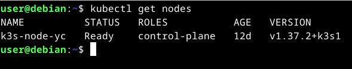
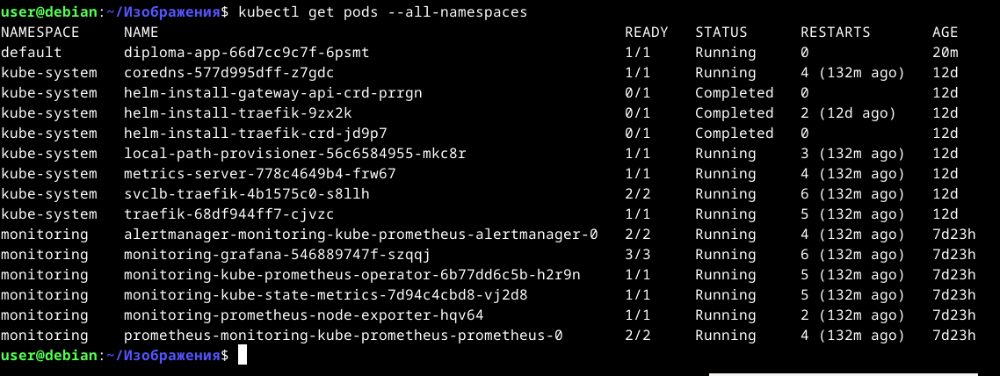

## Мониторинг

Установлен `kube-prometheus-stack` (Prometheus, Grafana, Alertmanager, node-exporter, kube-state-metrics) с кастомными values под 4 ГиБ RAM: отключены kubeProxy/kubeScheduler/kubeControllerManager (в k3s они встроены в основной процесс), отключены admission webhooks, заданы лимиты памяти для Prometheus и Grafana.

```bash
helm repo add prometheus-community https://prometheus-community.github.io/helm-charts
helm repo update
helm install monitoring prometheus-community/kube-prometheus-stack \
  -n monitoring --create-namespace \
  -f monitoring-values.yaml
```
Grafana: http://153.51.175.14:30081 (логин `admin`, пароль — в секрете `monitoring-grafana`).

Поды мониторинга: все в статусе `Running`.

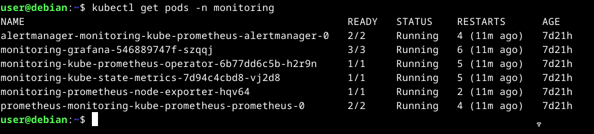
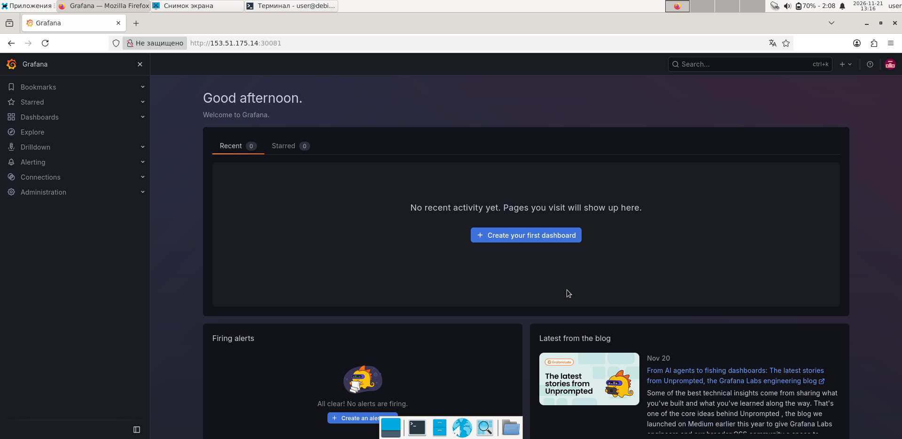
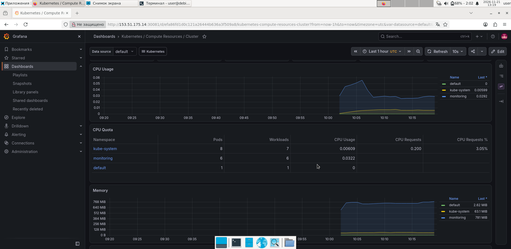

## Приложение

Тестовое статическое приложение (nginx) с образом `gitverse.ru/lar/diploma-app:v1.0.0`. Образ собирается в GitHub Actions репозитория `diploma-app` и пушится в GitVerse Registry. Деплой в кластер — по тегу `v*` через `kubectl set image`.

```bash
kubectl apply -f deployment.yaml
```
Приложение: http://153.51.175.14:30080 (NodePort 30080).

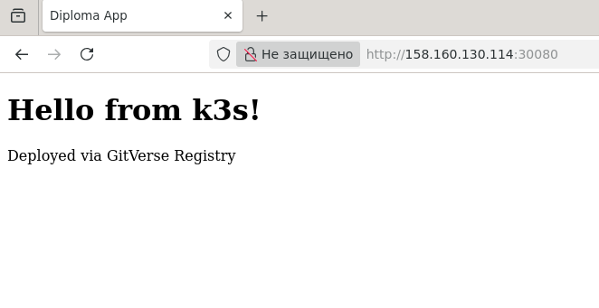
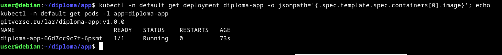

## Скриншоты

### Инфраструктура (Terraform)

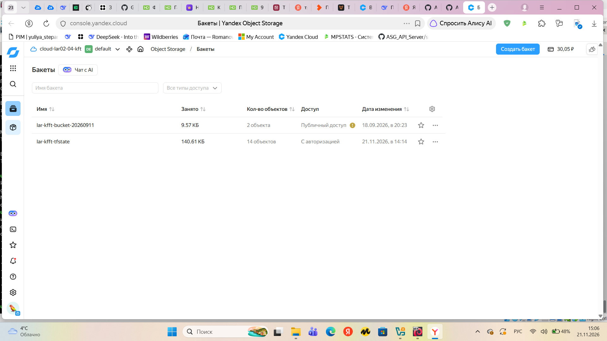
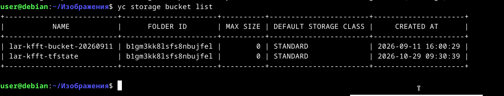

### Terraform pipeline (GitHub Actions)

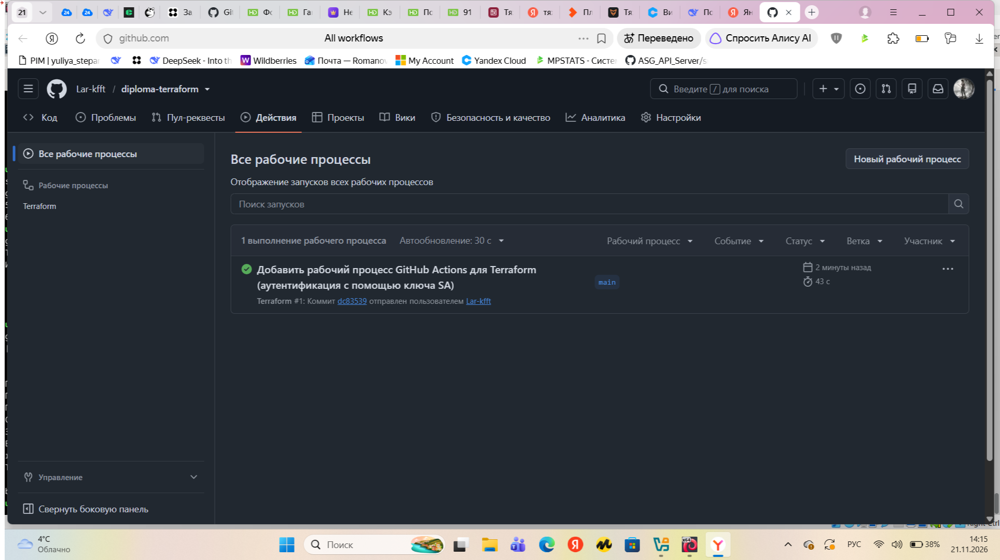

### CI/CD приложения (GitHub Actions)

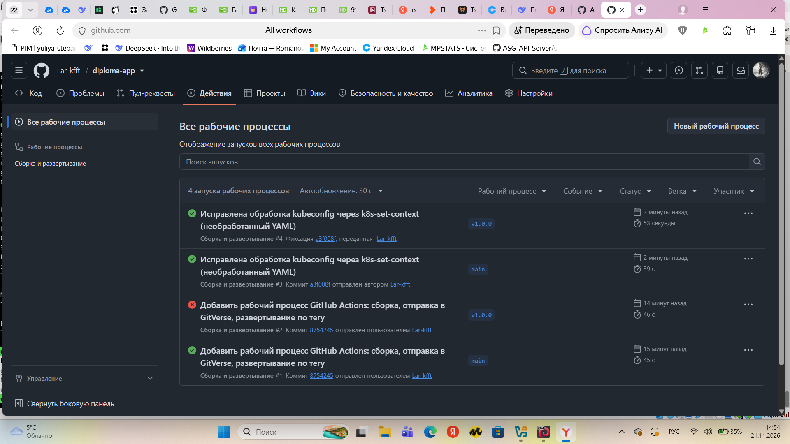

## Особенности окружения (РФ)

- GitVerse Registry используется вместо Docker Hub / Yandex Container Registry (Yandex Container Registry закрыт для новых пользователей с 13.10.2026).
- Базовый образ `nginx:alpine` тянется на этапе CI (GitHub Actions, Docker Hub доступен); в кластере используется уже собранный образ из GitVerse.
- CI/CD — GitHub Actions (доступен в РФ), аутентификация в Terraform workflow — через JSON-ключ сервисного аккаунта Yandex Cloud (не IAM-токен, чтобы не зависеть от 12-часового лимита).
- Terraform backend — S3-бакет `lar-kfft-tfstate` в Yandex Object Storage, что обеспечивает сохранение state между запусками CI.
